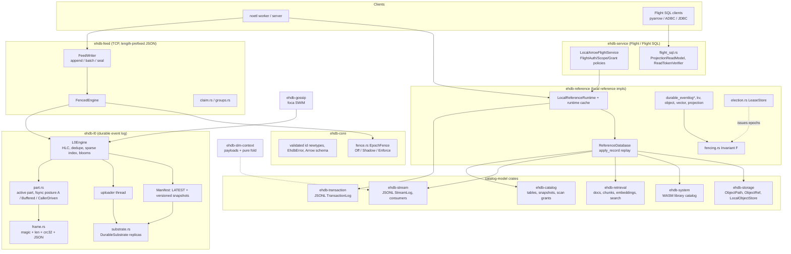

# EHDB design review (2026-11)

Scope: the whole workspace at `be76678`, read file by file. Every finding below
cites a `file:line` on the `review/design-notes` branch, where the same spot
carries an inline `TODO(review):` or `NOTE(review):` comment. This branch
changes **comments and docs only**; there is no behaviour change. `docs/SCOPE.md`
remains normative. This document does not change scope; it assesses the code
against it.

## 1. Architecture overview

Thirteen crates. The bottom layer is the L0 engine (the four-engine scope's
durable log). Above it, the reference/replay layer models the catalogs. The
networked faces (feed, Flight) sit on top.

**Write path (L0).** `FeedWriter::append` takes `FencedEngine::write` (fence
check, then the engine lock), then `L0Engine::append_record`. That stamps the
HLC, checks dedupe, and frames the record into the active part, fsyncing per
posture. When the part is full or old, it is sealed (renamed to
`shard-P-seq-MIN-MAX.eslog`) and registered in the in-RAM manifest. The
uploader thread copies sealed parts to N `DurableSubstrate` replicas and
publishes the `durable_view` of the manifest (durable parts only) as `LATEST`
plus a versioned snapshot. On cold start, the engine loads `LATEST`, surveys
local active and sealed files, and recovers the torn tail.

**Reference path.** `LocalReferenceRuntime::append` previews a
`TransactionRecord` and applies it to a clone of `ReferenceDatabase`. It then
appends the record to the JSONL `TransactionLog` and swaps the clone in. On
open, it replays the whole log.

## 2. Strengths

- **"Why" documentation is excellent.** Comments name the incident, the
  measurement and the rejected alternative, for example the feed keepalive
  rationale (`ehdb-feed/src/lib.rs`, `configure_stream` doc), the runtime-cache
  measurements (`ehdb-reference/src/lib.rs:200-238`), the torn-tail rule
  (`ehdb-transaction/src/lib.rs:466-519`), and `rust-toolchain.toml`.
- **Scope discipline.** `docs/SCOPE.md` is normative and the code follows it:
  vector is a scoped projection, not an ANN engine, and analytics is
  predefined views.
- **Validated identifier newtypes** and `#[serde(deny_unknown_fields)]` on
  every journal record, so replay rejects schema drift instead of guessing
  (e.g. `ehdb-catalog/src/lib.rs:36-99`, `ehdb-stream/src/lib.rs:146-170`).
- **Wire compatibility is pinned.** Frame format invariants and byte-identical
  CRC (`crates/ehdb-l0/tests/frame_format_invariants.rs`), manifest forward
  compatibility, and envelope additivity
  (`ehdb-stream/tests/record_envelope_additivity.rs`).
- **A large, failure-oriented test suite.** 63 integration test files in
  `crates/ehdb-l0/tests` (crash_recovery, append_failure_paths,
  stranded_active, tail_replication, nway_replication, orphan_reclaim_cost,
  and more), plus benches (`ehdb-l0/benches`, `ehdb-feed/benches`,
  `ehdb-catalog/benches`) and a CI gate with `clippy -D warnings`.
- **Fault-injection seams** (`ehdb-l0/src/fault.rs`) and explicit
  shadow-before-enforce rollouts for fencing (`ehdb-core/src/fence.rs`,
  `ehdb-reference/src/fencing.rs`) and election (`ehdb-reference/src/election.rs`).
- **Careful atomic swaps where they matter.** The reference runtime applies to
  a clone and swaps after the log write (`ehdb-reference/src/lib.rs:387-422`).
  The transaction batch path builds every record before writing a byte
  (`ehdb-transaction/src/lib.rs:584-621`). The system catalog validates on a
  clone (`ehdb-system/src/lib.rs:318-332`).
- **Secure-by-default Flight config.** Auth is off only on loopback; a
  non-loopback bind requires a policy (`ehdb-service/src/lib.rs`,
  `LocalArrowFlightServerConfig::validate`).

## 3. Issues, ranked

Severity: **P0** means acknowledged data can be lost or a store can become
unopenable. **P1** means a correctness, security or isolation gap. **P2** means
hygiene, performance or maintainability.

### P0: durability and recoverability

| # | Issue | Where |
|---|---|---|
| 1 | `reclaim_orphans` treats "not in the in-RAM manifest" as an orphan. After a restart, a sealed-but-not-yet-uploaded `.eslog` (acknowledged data) is not in the manifest loaded from `LATEST`, so it is deleted. | `ehdb-l0/src/engine.rs:1782` |
| 2 | `open_active` restarts `next_local_id` at 0, so only `part-000000.active` is re-adopted. Other acknowledged active parts are stranded (#396 surveys them but does not recover them). | `ehdb-l0/src/part.rs:163` |
| 3 | `LATEST` publication race. The version is allocated under the manifest lock but written outside it by the uploader and by merge/retention, so an older manifest can overwrite a newer one. Combined with the fixed tmp name in `write_atomic`, concurrent writers can also interleave bytes. | `ehdb-l0/src/engine.rs:801`, `ehdb-l0/src/substrate.rs:149` |
| 4 | `load_durable_manifest` returns the first replica's `LATEST`, not the newest across replicas, and does not fall back on a decode error. | `ehdb-l0/src/engine.rs:2820` |
| 5 | The transaction log skips a torn tail in memory but leaves it on disk. The next O_APPEND write lands on the same line, so the following open fails hard. One crash plus one append makes the log unopenable. | `ehdb-transaction/src/lib.rs:523` (and the batch doc claim at `:578`) |
| 6 | If `write_all` or `sync` fails in `part.rs` append, `byte_len`, `records` and marks diverge from the file, and the record can reappear on restart. Fix by truncating back to `mark_offset`. | `ehdb-l0/src/part.rs:349` |

### P1: correctness, isolation and security

| # | Issue | Where |
|---|---|---|
| 7 | Retrieval is not tenant-isolated. `document_by_id` matches bare ids and chunks are keyed globally, so equal document ids in two tenants cross-attach chunks and leak search results. | `ehdb-retrieval/src/lib.rs:425`, `:263` |
| 8 | Fencing TOCTOU. `FencedEngine::write` checks before taking the lock, and `EpochFence::check_and_advance` is an unlocked read-modify-write, so the high-water mark can regress. | `ehdb-feed/src/fenced_engine.rs:134`, `ehdb-core/src/fence.rs:328` |
| 9 | The fence marker is not fsynced (a regression from the reference port, which does `sync_all`). After power loss the fence can forget an epoch it accepted. | `ehdb-core/src/fence.rs:349` vs `ehdb-reference/src/fencing.rs:240-253` |
| 10 | Feed `read_frame` is not cancel-safe but is wrapped in `timeout`; the demote path then `continue`s on a possibly desynced stream. The same applies in `claim.rs` and `groups.rs`. | `ehdb-feed/src/lib.rs:247`, `claim.rs:943`, `groups.rs:701` |
| 11 | No authentication on any feed face. The 64 MiB frame cap applies before the handshake, so unauthenticated peers can force large allocations, and there is no handshake timeout. | `ehdb-feed/src/lib.rs:254`, `:627` |
| 12 | Flight auth: the token comparison is not constant-time; `Debug` prints the token; there is one shared token, and principal, tenant and namespace come from client headers, so catalog grants are only advisory. | `ehdb-service/src/lib.rs:57`, `:108` |
| 13 | Flight SQL is unscoped. `list_executions(limit)` has no tenant, and `serve` lacks the loopback guard, size limits and concurrency limits of the Arrow Flight config. | `ehdb-service/src/flight_sql.rs:89`, `:650` |
| 14 | The stream and system JSONL journals fail the whole open on a torn final line, unlike the transaction log. | `ehdb-stream/src/lib.rs:615`, `ehdb-system/src/lib.rs:306` |
| 15 | `LocalObjectStore::put_if_absent` writes in place with no fsync. A crash leaves a short object that `create_new` makes impossible to rewrite. | `ehdb-storage/src/lib.rs:489` |
| 16 | `substrate.rs` `put_if_absent` is exists-then-write, with no directory fsync after renames. The same gap applies to the seal rename in `part.rs`. | `ehdb-l0/src/substrate.rs:192`, `ehdb-l0/src/part.rs:570` |
| 17 | `append_record` can return `Err` after the record is already durable (seal or register failure), so a retry without `event_id` duplicates it. A failed rename leaves the writer with no active file. | `ehdb-l0/src/engine.rs:964` |
| 18 | In a sealed part, a corrupted length field reads as a torn tail, so the rest of the part is silently truncated on read. | `ehdb-l0/src/frame.rs:101` |
| 19 | The declared MSRV is false. `rust-version = "1.82"`, but foca 2 needs 1.88, so 1.85 fails to build. The pinned 1.99 toolchain hides this. | `Cargo.toml:23`, `crates/ehdb-gossip/Cargo.toml:16` |
| 20 | The HLC seed `Hlc::from_parts(0,0)` contradicts its comment, and there is no `observe()` of recovered maxima. | `ehdb-l0/src/engine.rs:711` |

### P2: hygiene, performance and structure

- Uploader read errors and all manifest-write errors are swallowed with no
  metric (`ehdb-l0/src/engine.rs:769`, `:2679`).
- The `shard_tail_max` canary advances before the append it guards
  (`engine.rs:920`). The early break in `read_partition_after_limited` assumes
  parts do not overlap, which is not enforced (`engine.rs:2099`).
- Chain-cert absorb runs before the write, contrary to its own comment
  (`ehdb-l0/src/part.rs:324`).
- The CRC is computed bit by bit (`ehdb-l0/src/frame.rs:30`). A table-driven
  or hardware version gives byte-identical output.
- The feed uses a blocking `std::sync::Mutex` plus fsync inside tokio tasks
  (`ehdb-feed/src/lib.rs:422`).
- `EhdbError` is five `String` variants (`ehdb-core/src/lib.rs:20-26`). As a
  result, callers parse messages back into variants
  (`ehdb-transaction/src/lib.rs:695`). Use structured variants and `#[source]`.
- The catalog `TableId` is a non-injective `_` join (`ehdb-catalog/src/lib.rs:125`).
  Snapshot files are not prefix-checked, and there is no drop, revoke or
  expiry (`:155`).
- `ReferenceDatabase::apply_record` is non-atomic, with the safety provided by
  callers. Cloning per append is O(state) (`ehdb-reference/src/lib.rs:2012`).
- `ObjectPath` allows `a//b` and a trailing `/`, and rejects legal `..` inside
  names (`ehdb-storage/src/lib.rs:16`). `ObjectRef` and `ObjectReplica` are
  field-for-field identical (`ehdb-storage/src/lib.rs:288-302`).
- The stream journal writes unbuffered, encodes `Vec<u8>` as JSON number
  arrays, and is never compacted (`ehdb-stream/src/lib.rs:775`).
- Retrieval search is a full scan and sort, and the hybrid score scales are
  not comparable (`ehdb-retrieval/src/lib.rs:263`).
- Four hand-rolled JSONL journals (stream, transaction, system, reference)
  have diverging torn-tail rules. Two epoch-fence implementations exist
  (`ehdb-core/src/fence.rs`, `ehdb-reference/src/fencing.rs`), and two Flight
  auth models (`FlightAuthPolicy`, `ReadTokenVerifier`).
- Very large files: `ehdb-service/src/lib.rs` (8748 lines),
  `ehdb-reference/src/lib.rs` (4690), `durable_eventlog.rs` (4000),
  `durable_eventlog_shared.rs` (2673), `ehdb-l0/src/engine.rs` (~2840).
  `ehdb-l0` exports 42 public modules from one crate, including
  `chain_alt.rs` (documented as "sketches, deliberately incomplete") without
  a feature gate (`ehdb-l0/src/lib.rs:136-178`). Only `chain_cert` is gated.
- `manifest.lock().unwrap()` throughout `engine.rs` means one panic poisons
  every later call. The uploader thread is spawned with `.expect`.
- Overflow: `StreamSequence::next` and `TransactionSequence::next` use
  unchecked `+ 1` (`ehdb-stream/src/lib.rs:31`, `ehdb-transaction/src/lib.rs:30`).
- A stray tracked binary, `real_active.bin`, sits at the repo root.
- Doc drift was fixed on this branch: misplaced rustdoc blocks in `engine.rs`,
  `dataset.rs` and `ehdb-feed/src/lib.rs` were moved onto their functions,
  stale "disarm on first miss" docs were annotated, and the README crate list
  was completed.

## 4. Recommendations (in order)

1. **Close the P0 durability holes first.** These are mostly small, local
   fixes:
   - Make `reclaim_orphans` keep any `.eslog` whose sequence range is above
     the durable manifest's high-water mark, and upload it instead of
     deleting it.
   - Scan for all `part-*.active` files at open.
   - Allocate and publish `LATEST` under one lock with unique tmp names, and
     pick the newest `LATEST` across replicas.
   - Truncate torn tails on disk (transaction log, and `part.rs` on a failed
     append).
2. **Add one shared `Journal` type** in `ehdb-core` for JSONL logs. It should
   provide a buffered single write, `sync_data`, torn-tail truncation, a
   counter, and optional compaction. Port stream, transaction, system and
   reference onto it.
3. **Make the fence atomic and durable.** Use a per-shard lock around
   check-and-advance, fsync the marker and its directory, and re-check under
   the engine guard. Keep one fence implementation.
4. **Tenant-scope every key** in retrieval, and thread a verified scope
   through Flight SQL. Bind principal and tenant to the credential, not to
   headers. Redact `Debug`, and use constant-time compares.
5. **Feed hardening.** Add a cancel-safe frame reader, a small handshake cap
   and timeout, `spawn_blocking` for the lock and fsync section, and an
   authentication option.
6. **Errors and structure.** Use structured `EhdbError` variants. Split
   `ehdb-service/src/lib.rs` and `ehdb-reference/src/lib.rs` into modules, and
   feature-gate sketch modules such as `chain_alt`.
7. **Tooling.** Set a truthful `rust-version` with an MSRV CI job, move
   gossip dependencies to the workspace, and remove `real_active.bin`.
